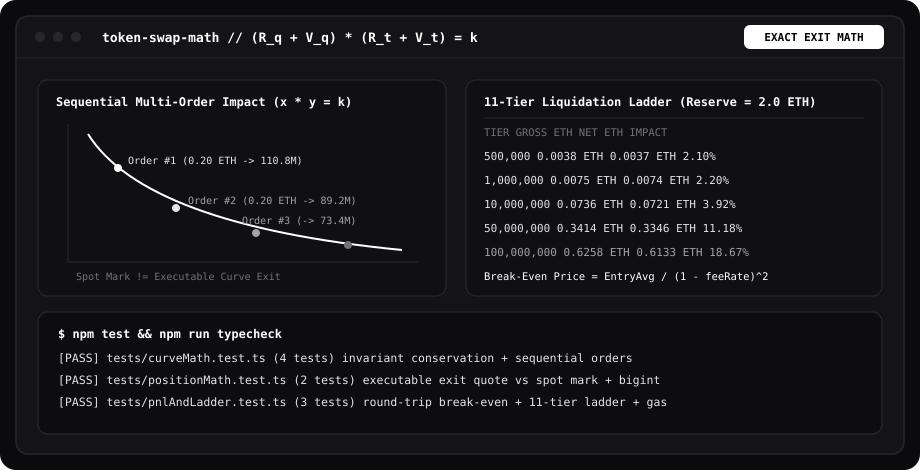

# token-swap-math


when i wrote this math at 4am only me and bhagwan knew how the slippage formula worked. now only bhagwan knows, plus the unit tests. most apps show fake profit using spot price, then pool slippage eats half your money on sell. this library tells you the real number before you click swap.



## what is this

this is a fast TypeScript math library for `x * y = k` token pools. it has zero runtime packages.

* it calculates exact tokens out when you buy with ETH.
* it calculates real ETH out after fees and price drop when you sell.
* it simulates multiple buy orders in a row so you see how order 1 pushes price up for order 2.
* it builds an 11 step sell ladder from 10K tokens to 100M tokens.
* it tracks real profit, loss, and exact break even price after round trip fees.

## copy and run in 60 sec

```bash
git clone https://github.com/LevCodeLab/token-swap-math.git
cd token-swap-math
npm install
npm test
npm run typecheck
```

quick code example:

```ts
import {
  simulateSequentialSwaps,
  calculateExecutableExitQuote,
  LiquidationLadder
} from "./src";

const buys = simulateSequentialSwaps([0.2, 0.2, 0.2], 0, 100);
console.log("tokens per buy:", buys.orderTokens);

const quote = calculateExecutableExitQuote({
  tokensIn: 10_000_000,
  totalTokensHeld: 20_000_000,
  realQuoteReserveEth: buys.finalQuoteReserveEth,
  spotPriceEth: 0,
  ethPriceUsd: 3000
});
console.log("fake spot usd:", quote.markValueUsd, "real receive usd:", quote.netQuoteUsd);

const ladder = LiquidationLadder.computeLadder(buys.finalQuoteReserveEth, 100, 20_000_000);
console.log("ladder steps:", ladder.length);
```

## how to edit files

you can tweak any pool number in seconds.

* `src/curveMath.ts`: edit `AMM_CURVE_CONSTANTS` to change virtual ETH, token supply, or base fee.
* `src/positionMath.ts`: edit `calculateExecutableExitQuote` or compact USD and ETH text helpers.
* `src/liquidationLadder.ts`: edit `STANDARD_TIERS` to put your own token sell sizes.
* `src/pnlEngine.ts`: edit wallet profit, ROI percent, and break even math here.
* `src/feeCalculator.ts`: edit gas buffer multiplier (`1.35`) and fallback gas numbers here.

## license

MIT. see [LICENSE](./LICENSE).
